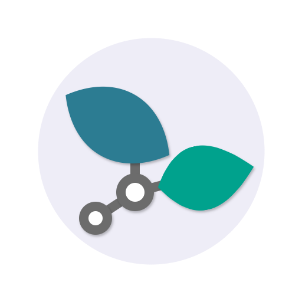

# nonoha-engine

<p align="center">
    
</p>

A visual node-based programming engine for data processing, device integration, and real-time analysis. It builds graphs by combining nodes, loads plugins, and exchanges data with other applications over REST and WebSocket APIs. It can also serve the built editor and a web UI of your own.

## The nonoha ecosystem

nonoha is node-based programming redesigned for the era of developing together with AI: a Python framework for real-time signal processing and applications. AI agents write a graph as code, people edit the same graph as a diagram, and an engine with no GUI runs it.

<a href="https://hub.nonoha.dev/ecosystem/">
  <picture>
    <source media="(prefers-color-scheme: dark)" srcset="https://hub.nonoha.dev/screens/ecosystem-dark.webp">
    
  </picture>
</a>

| Layer | Codebases |
| --- | --- |
| Tools and UIs | [nonoha Hub and its CLI](https://hub.nonoha.dev/), [nonoha-editor](https://github.com/viestyle-dev/nonoha-editor), your own web UI or app |
| Clients | [nonoha-client-js](https://github.com/viestyle-dev/nonoha-client-js) |
| Runtimes | **nonoha-engine** (this repository; standalone), [nonoha-embedded](https://github.com/viestyle-dev/nonoha-embedded) (inside an app) |
| Nodes | [sci-nodes](https://github.com/viestyle-dev/sci-nodes), [plugins](https://hub.nonoha.dev/plugins/) |
| Core | [nonoha-core](https://github.com/viestyle-dev/nonoha-core) |

The [nonoha website](https://hub.nonoha.dev/) has the [documentation](https://hub.nonoha.dev/docs/) and [workspaces](https://hub.nonoha.dev/workspaces/) to start from.

## Quick Start

### Prerequisites

- Python 3.11
- [uv](https://github.com/astral-sh/uv) package manager
- Git (for submodules)

### Installation

1. **Clone with submodules:**
```bash
git clone --recursive https://github.com/viestyle-dev/nonoha-engine.git
cd nonoha-engine

# If you already cloned without submodules:
git submodule update --init --recursive
```

2. **Install dependencies:**
```bash
uv sync
```

3. **Start the engine:**
```bash
# Basic startup
uv run python main.py

# With the bundled template workspace (plugins + sample app)
uv run python main.py --vnf templates/default/flows/default.vnf --plugins ./templates/default/plugins

# Custom port
uv run python main.py --port 8001
```

The engine API will be available at `http://localhost:8000` (or your specified port).

## Editor

The engine serves [nonoha-editor](https://github.com/viestyle-dev/nonoha-editor), the browser-based graph editor, at `/editor`:


Build the editor (Node.js 18.17 or later) and pass the build to the engine:

```bash
git clone --recursive https://github.com/viestyle-dev/nonoha-editor.git ../nonoha-editor
cd ../nonoha-editor
npm ci
NEXT_PUBLIC_BASE_PATH=/editor npm run build   # PowerShell: $env:NEXT_PUBLIC_BASE_PATH="/editor"; npm run build
cd ../nonoha-engine
uv run python main.py --editor-html ../nonoha-editor/out
```

Then open `http://localhost:8000/editor`. Without `--editor-html`, the engine serves `editor_html/` in the repository root (not committed) when it exists.

## Command Line Options

```bash
uv run python main.py [OPTIONS]

Options:
  --vnf PATH            Path to VNF (Visual Node Flow) file
  --plugins PATH        Path to plugins directory
  --host HOST           Address to listen on (default: 127.0.0.1; 0.0.0.0 for access from other machines)
  --port INT            Server port (default: 8000)
  --editor-html PATH    The editor's build to serve at /editor (default: editor_html/)
  --readonly            Read-only mode: changes are not saved to disk
  --inspector on|off    Inspector WebSocket endpoint for live port sampling (default: on)
  --allow-host NAME     Accept this Host name (tunnels, VPN or company DNS names). Repeatable
  --allow-origin ORIGIN Accept requests from pages at this origin (e.g. https://dash.example.com). Repeatable
  --env-file PATH       The .env file with this deployment's environment values
  --log-level LEVEL     Logging level (DEBUG, INFO, WARNING, ERROR, CRITICAL)
  --debug-save-log      Save logs to file for debugging
  --version             Show version information
  --help                Show help message
```

## Tips

### Graceful Shutdown with stdin

Type `"quit"` in stdin to trigger a graceful shutdown process and terminate the engine properly.

```bash
# While engine is running:
quit
# → Shutdown process executes and the process terminates gracefully
```

**Use cases:**
- Useful when sending `CTRL+C` (SIGINT) is difficult, especially on Windows
- Avoids issues where `CTRL_C` events cannot be sent to different process groups, and sending `CTRL_C` to the same process group terminates the parent process as well

### Debug Logging to File

Use the `--debug-save-log` option to save all logger output to a file for debugging purposes.

```bash
uv run python main.py --debug-save-log
# → Logs are saved to logs/nonoha_engine_YYYYMMDD_HHMMSS_PID.log
```

**Use cases:**
- Debugging when launched as a subprocess
- Monitoring logs during background execution
- Capturing error logs for investigation

**Note:**
- Log files are not automatically rotated
- Be mindful of disk space for long-running processes
- Intended for debugging purposes only

## Testing

```sh
uv sync

# Run all tests with showing output
uv run pytest tests -s
```

### Run Specific Test File

```bash
uv run pytest tests/test_record_nodes.py -s
```

### Run with Verbose Output

```bash
uv run pytest tests -v -s
```

## Performance Profiling

### CPU Profiling

1. **Using py-spy (Recommended for production):**
```bash
# Install py-spy
pip install py-spy

# Profile a running process (non-intrusive)
py-spy record -o profile.svg --pid 18592

# Profile a script from start
py-spy record -o profile.svg -- python main.py

# Real-time top-like view
py-spy top --pid 18592
```

2. **Using cProfile:**
```python
import cProfile
import pstats

# In your code
profiler = cProfile.Profile()
profiler.enable()

# ... your code to profile ...

profiler.disable()
stats = pstats.Stats(profiler)
stats.sort_stats('cumulative')
stats.print_stats(20)  # Top 20 functions
```

3. **Using line_profiler:**
```bash
# Install
uv pip install line_profiler

# Decorate functions with @profile
# Run with:
uv run kernprof -l -v your_script.py
```

### Memory Profiling

```bash
# Install memory profiler
uv pip install memory_profiler

# Run with:
uv run python -m memory_profiler your_script.py
```

### Real-time Monitoring

```python
import tracemalloc
import numpy as np

# Start tracing
tracemalloc.start()

# ... your code ...

# Get current memory usage
current, peak = tracemalloc.get_traced_memory()
print(f"Current memory: {current / 10**6:.1f} MB")
print(f"Peak memory: {peak / 10**6:.1f} MB")

tracemalloc.stop()
```

## API Documentation

The engine provides REST and WebSocket APIs for node flow management.

📚 **[Full API Documentation](./docs/api-reference.md)**

### Quick Examples

**Python Client:**
```python
import requests

# Get available graphs
response = requests.get("http://localhost:8000/node-flow/graphs")
graphs = response.json()

# Create a node
node_data = {
    "type": "AddNumber",
    "preferred_name": "adder1",
    "properties": {"value": 10.0}
}
response = requests.post(
    f"http://localhost:8000/node-flow/graphs/main/nodes",
    json=node_data
)
```

**JavaScript/TypeScript Client:**
```javascript
// Using fetch API
const response = await fetch('http://localhost:8000/node-flow/graphs');
const graphs = await response.json();

// WebSocket connection
const ws = new WebSocket('ws://localhost:8000/node-flow/graphs/main/endpoint/ws');
ws.onmessage = (event) => {
    // Handle binary data
    const data = new Uint8Array(event.data);
};
```

### Client Libraries

#### Official Clients

- **TypeScript/JavaScript**: [nonoha-client-js](https://github.com/viestyle-dev/nonoha-client-js)
  - Full TypeScript support
  - REST and WebSocket APIs
  - Binary protocol handling
  
- **Flutter/Dart**: [flutter_nonoha_engine_client](https://github.com/viestyle-dev/flutter_nonoha_engine_client)
  - Cross-platform mobile support
  - Real-time data streaming
  - Native performance
  
- **Unity/C#**: [UnityVieNodeEngineClient](https://github.com/viestyle-dev/UnityVieNodeEngineClient)
  - Unity integration
  - Game engine compatibility
  - 3D visualization support

- **Python**: Use standard libraries
  - `requests` for REST API
  - `websocket-client` for WebSocket

## For AI Agents

See [AGENTS.md](./AGENTS.md) for a comprehensive guide designed for AI coding agents (Claude Code, Cursor, etc.). It covers node implementation patterns, plugin structure, custom app development, and API reference.

## Plugin Development

Extend the engine functionality with custom nodes.

📚 **[Plugin Development Guide](./docs/plugin-system/README.md)**

### Quick Plugin Example

```python
# plugins/my-plugin/my_plugin/__init__.py
from nonoha_core.node_registry import NodeRegistry
from nonoha_core.node import BaseNode

class MyCustomNode(BaseNode):
    def __init__(self, name: str):
        super().__init__(name, "MyCustomNode")
        # ... setup ports and properties ...

def register_nodes(registry: NodeRegistry):
    registry.register_node("MyCustomNode", MyCustomNode)
```

## Project Structure

```
nonoha-engine/
├── nonoha_engine/          # Core engine code
│   ├── node_flow/          # Node flow management
│   ├── plugin_management/  # Plugin system
│   └── webrtc_gateway/     # WebRTC support
├── packages/               # Submodule packages
│   ├── nonoha-core/        # Core node definitions (submodule)
│   └── sci-nodes/          # scipy-dependent nodes (submodule)
├── templates/              # Workspace templates (copied by nonoha-hub)
│   └── default/            # Default template (plugins, flows, app)
├── tests/                  # Test suite
├── docs/                   # Documentation
│   ├── api-reference.md    # API documentation
│   └── plugin-system/      # Plugin docs
└── AGENTS.md               # AI agent development guide
```

## Building for Production

### Using PyInstaller

```bash
# Build executable
uv run pyinstaller main.spec --noconfirm --clean

# Output will be in dist/nonoha-engine/
```

### Docker Deployment

```dockerfile
FROM python:3.11-slim
WORKDIR /app
COPY . .
RUN pip install uv && uv sync
CMD ["uv", "run", "python", "main.py"]
```

## Troubleshooting

### Common Issues

**Port already in use:**
```bash
# Change port
uv run python main.py --port 8001
```

**Plugin not loading:**
- Check `manifest.json` exists in plugins directory
- Verify plugin is listed and enabled in manifest
- Check plugin structure follows conventions

**Memory issues with large data:**
- Use chunked processing for large arrays
- Monitor memory with profiling tools
- Consider using `numpy.memmap` for huge datasets

## Versioning

Follows [Semantic Versioning](https://semver.org/) from 1.0.0. Within a
major version, plugins keep working: the plugin entry points
(`register_nodes`, `finalize`), the bundled nonoha-core API, the supported
Python range, and the NumPy major version stay compatible. A plugin built
for 1.x can declare compatibility with `>=1.0.0, <2.0.0`.

## Contributing

Contributions are welcome — see [CONTRIBUTING.md](CONTRIBUTING.md).
Pull requests require signing the [nonoha CLA](CLA.md) (a one-time
comment on your first PR, shared across the nonoha repositories).

## Security

See [SECURITY.md](SECURITY.md) for how to report vulnerabilities and
for the engine's threat model (graphs and plugins execute code).

## License

nonoha-engine is dual-licensed:

- **[AGPL-3.0-only](LICENSE)** — free for any use, including commercial,
  as long as you comply with the AGPLv3 obligations.
- **Commercial license** — for distribution without the AGPLv3
  obligations. Small projects receive an automatic free grant: those
  who build with it qualify while the end product's development cost
  is under JPY 5,000,000, and those who earn from the product itself
  while their revenue from it is under JPY 5,000,000 — see
  [COMMERCIAL-LICENSE.md](COMMERCIAL-LICENSE.md) (English) /
  [COMMERCIAL-LICENSE_ja.md](COMMERCIAL-LICENSE_ja.md) (Japanese
  original; authoritative).

Code examples in this README, AGENTS.md, and docs/, the templates in
templates/, and the sample flows in flows/ are provided under the MIT No
Attribution License (MIT-0; see the LICENSE file in docs/, templates/,
and flows/), so you can copy them into your own work without attribution.

Commercial licensing contact: <https://www.viestyle.co.jp/contact/>

Copyright 2026 VIE, Inc.

## Support

- 📖 [Documentation](./docs/)
- 🐛 [Issue Tracker](https://github.com/viestyle-dev/nonoha-engine/issues)
- 💬 [Discussions](https://github.com/viestyle-dev/nonoha-engine/discussions)
